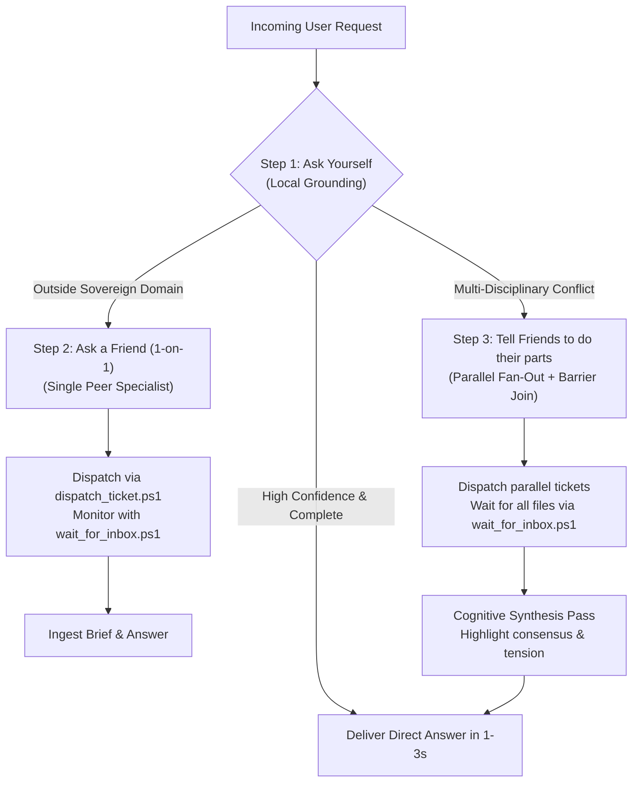

# /maw-conduct — Cognitive Orchestration & 3-Step Escalation via MAW

> "Any Oracle can orchestrate. Ground locally, consult peers, synthesize reality."

## 1. When to Use
Use `/maw-conduct` whenever you receive a complex goal or research question that might exceed your sovereign domain knowledge, or when you need cross-disciplinary verification from peer Oracles (e.g. Keth for civil service laws, Jiu for climate risk modeling, Lauren for data architecture, Creagy-Writing for institutional prose).

---

## 2. The 3-Step Cognitive Escalation Workflow



### Step 1: Ask Yourself (Local Grounding)
Before crossing any Oracle boundaries:
1. Search your local knowledge base (`oracle_search`, `oracle_read`).
2. Inspect local code, SQLite databases, and project ledgers.
3. If local confidence is High and complete: Deliver the answer immediately. Do NOT burn peer tokens unnecessarily.

### Step 2: Ask a Friend (1-on-1 Specialist Consultation)
If the question belongs to a sovereign peer's domain:
1. Identify target peer:
   - **Keth**: Thai public administration, civil service law, `bureaucrazy.sqlite`.
   - **Jiu**: Climate risk modeling, hazard indices, CRI rasters, DaLA/PDNA.
   - **Lauren**: Common Data Model (CDM), schemas, relational pipelines.
   - **Creagy-Writing**: Formal Thai institutional writing, prose polish.
2. Run `dispatch_ticket.ps1`:
   ```powershell
   pwsh -File .agents/skills/maw-conduct/scripts/dispatch_ticket.ps1 `
       -Target "keth" `
       -Requester "<your_oracle_name>" `
       -RequesterInboxDir "<your_repo_root>\ψ\inbox" `
       -Topic "Statutory Authority" `
       -Objective "Verify DCCE authority under Draft Climate Change Act Chapter 12."
   ```
3. Run `wait_for_inbox.ps1` in the background (or run command) to monitor the expected deliverable path.
4. Once the brief lands, read `ψ/inbox/from-<target>/<file>.md` and provide the answer to Boss.

### Step 3: Tell Friends to Do Their Parts (Multi-Oracle Convergence)
If the inquiry spans multiple domains (e.g. Science vs Law vs Data Architecture):
1. Break down the user's inquiry into bounded, domain-specific tickets.
2. Dispatch tickets in parallel to each specialist using `dispatch_ticket.ps1`.
3. Launch the File-Join Barrier Waiter:
   ```powershell
   pwsh -File .agents/skills/maw-conduct/scripts/wait_for_inbox.ps1 `
       -Paths @(
           "<your_repo_root>\ψ\inbox\from-keth\<ticket1>.md",
           "<your_repo_root>\ψ\inbox\from-jiu\<ticket2>.md"
       )
   ```
4. Once **all** files exist, perform a cognitive synthesis pass:
   - Highlight points of consensus.
   - Reconcile tensions (e.g. statutory constraints vs technical modeling requirements).
   - Deliver a unified, citation-backed brief to Boss in Obsidian.

---

## 3. Headless Ad-Hoc Convergence vs. Visual Team Canvas

| Mode | Command | When to Use |
| :--- | :--- | :--- |
| **Ad-Hoc File-Join (Default)** | `/maw-conduct` (headless `maw hey`) | Fast, zero tmux overhead, zero context pollution. Each specialist works in their own session and deposits to your inbox. |
| **Visual Team Canvas** | `/maw-room create <team>` | Use when Boss wants to visually watch the team side-by-side in tiled tmux panes or for long-running collaborative sprints. |

---

## 4. Hard Rules
1. **Encapsulation**: NEVER query foreign databases or private vector chunks across boundaries. Always use structured tickets.
2. **Zero Polling Tokens**: Always use `wait_for_inbox.ps1` with background tasks to wait for files without burning continuous LLM tokens.
3. **No Uncurated Knowledge Writes**: Never dump foreign deliverables into `ψ/memory/knowledge/`.
